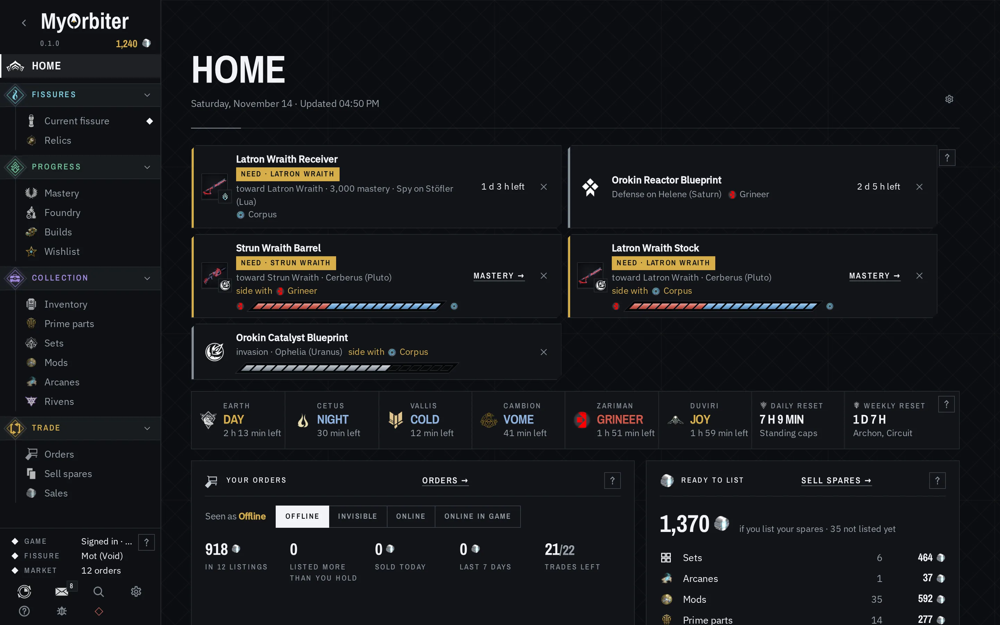

# MyOrbiter, the Warframe companion

MyOrbiter is a desktop companion for Warframe, for Linux, the Steam Deck and Windows. It reads what
TennoScope stores on your PC (the game's log, the fissure reward screen and, if you allow it, your
inventory) and answers what the game doesn't: which reward to take, what to sell and for how much,
what's left to master, and which relics finish your sets. It can also keep your warframe.market
listings at the market price (the second-cheapest seller online or in game).

**Unofficial.** MyOrbiter is a fan-made tool, not affiliated with or endorsed by Digital Extremes.
Warframe and its artwork are © and ™ Digital Extremes Ltd.



The screenshot shows an invented account (`demo/`), not a real one.

## Full mode is your call

With Full mode on (it's off unless you turn it on), TennoScope reads the game's memory to fetch your
inventory. Digital Extremes publishes no list of allowed or forbidden third-party programs and
[leaves using them at your own risk](https://forums.warframe.com/topic/1383123/): Full mode could
put your account at risk, so you choose whether to turn it on. It doesn't write to the game's
memory, and only sends your login session to Digital Extremes and the names of reward items read
from the screen to warframe.market, for their prices. [What MyOrbiter reads and sends](docs/privacy.md)
lists everything it reads, every host it talks to, and every file it keeps; there's no telemetry.

**It acts on your warframe.market account.** Once you sign in, what you press and the automatic
features you turn on (repricing, marking sales sold, +rep, hiding your last copies, holding your
online status; each is off until you turn it on) list, change and close orders and post reviews as
you.

## Install

Download the latest Stable build from
[the website](https://shezisssnake.github.io/myorbiter/#download) (every build, Beta and
Experimental too, is on [Releases](https://github.com/ShezissSnake/myorbiter/releases)).
TennoScope is inside it; there is nothing else to install.

- **Linux and Steam Deck:** `myorbiter_<version>_amd64.AppImage`. Make it executable
  (`chmod +x myorbiter_*.AppImage`, or *Properties → Permissions → Is executable* in Dolphin), then
  run it.
- **Windows:** `myorbiter_<version>_x64-setup.exe`. It installs for your user only. It isn't signed,
  so SmartScreen warns the first time: *More info → Run anyway*.

If the window stays blank or flickers on Linux, start it once with `--compat-rendering`.
[docs/install.md](docs/install.md) has the details: the Steam Deck, consoles, macOS, updates.

### Checking a download

Download `SHA256SUMS` from the same release into the same folder, then:

- **Linux:** `sha256sum --check --ignore-missing SHA256SUMS`. It should say `OK` beside your file.
- **Windows (PowerShell):** `Get-FileHash .\myorbiter_<version>_x64-setup.exe`, then compare the hash
  with its line in `SHA256SUMS`.

## Run it from source

You need Rust 1.95, Node 20.19+ or 22.12+, and webkit2gtk-4.1.
[docs/development.md](docs/development.md) has the rest.

```fish
npm install
npm run tauri dev        # a development window
npm run dev:demo         # the interface in a browser, on the invented account
npm test
```

## Licence

MyOrbiter is free software under the GPL-3.0-only ([LICENSE](LICENSE)), with no warranty. The written
offer for the GPL and LGPL libraries in the downloads, and every other licence, are in
[NOTICE.md](NOTICE.md). Digital Extremes' artwork is not covered by the GPL.

MyOrbiter is written largely by AI (Claude, by Anthropic), directed by its maintainer, who decides
what is built and what is released. [The code is open for anyone to read](https://github.com/ShezissSnake/myorbiter).

## Reporting a bug

In MyOrbiter, Shift+F1 opens *Report a bug*, which shows you the report first. *Open on GitHub*
puts it on the clipboard and opens the issue form on github.com in your browser (with only the app's
version and your system in its address), for you to paste it into and submit; *Copy report* only
puts it on the clipboard. MyOrbiter posts nothing by itself. Security problems go through [SECURITY.md](SECURITY.md).

## More

- [The Guide](https://shezisssnake.github.io/myorbiter/guide/) (also in the app: F1) and
  [What's New](https://shezisssnake.github.io/myorbiter/whats-new.html)
- [docs/](docs/): what MyOrbiter does, [what it reads and sends](docs/privacy.md), running it from source, releases
- [The website](https://shezisssnake.github.io/myorbiter/)
- Development, issues, releases and the website are on [GitHub](https://github.com/ShezissSnake/myorbiter).
  [GitLab](https://gitlab.com/sheziss-group/myorbiter) keeps builds 0.2.100 to 0.2.119 and the
  fallback update feed.
