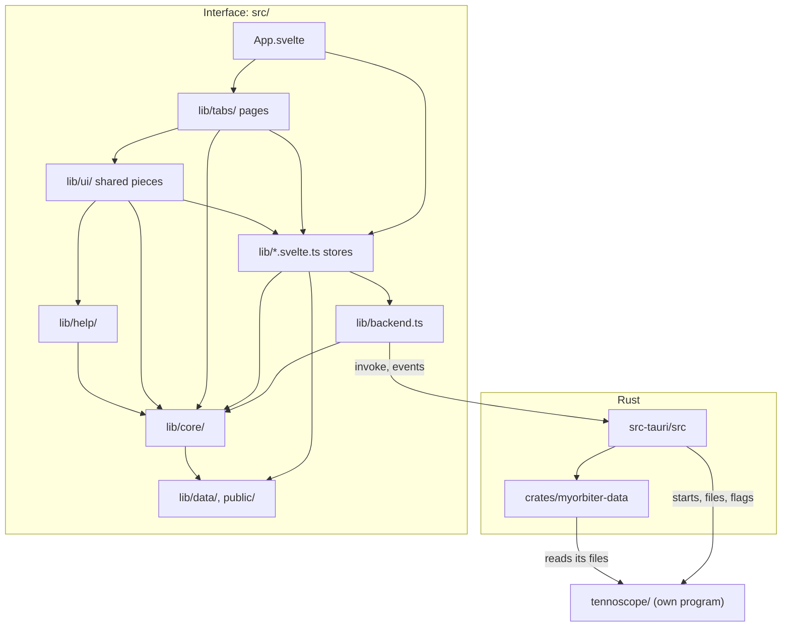
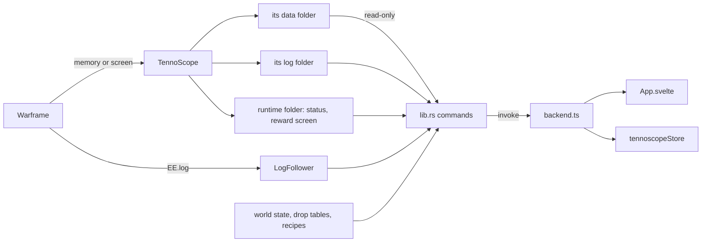
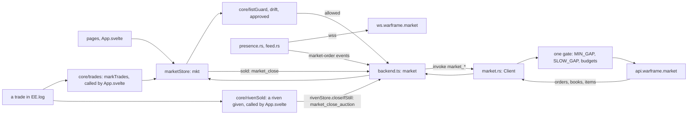
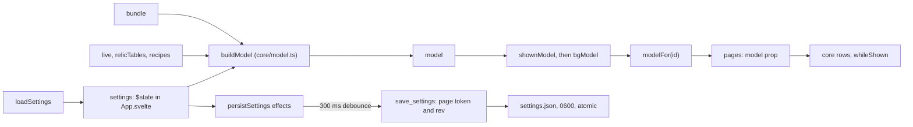
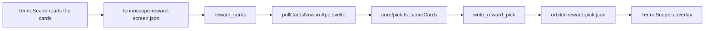
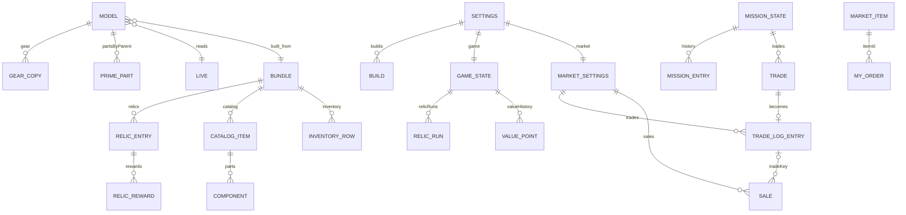

# How MyOrbiter is built

The parts of the code, what each may know of the others, how data moves through them, and the
patterns a change follows. Every section names the files it rests on. Other documents say what the
app reads and keeps ([privacy.md](privacy.md)), what each page does ([features.md](features.md)),
how to run and test it ([development.md](development.md)), why Sell spares works as it does
([design/spares-plan.md](design/spares-plan.md)) and what TennoScope's folder is
([../tennoscope/ORBITER.md](../tennoscope/ORBITER.md)); this one does not repeat them. "Held by"
says what makes a rule true: a test, a build file, or only the code.

## 1. The parts and their borders

The arrows are "may import" or "may ask", not data flow; every part above the bridge may also import
`backend.ts` (`core/` for types only, two exceptions below). Scripts, tests and the demo sit outside
it: they read these parts and nothing in the app reads them.

| Part | For | Files | May know | May not know |
| --- | --- | --- | --- | --- |
| Data crate | Reading TennoScope's folder (inventory, catalogs, prices, its log) and the game's `EE.log`, read-only. Its own types, shipped to the page as JSON. | `crates/myorbiter-data/src/lib.rs`, `ee_log.rs`, `reward_log.rs`, `bin/dump.rs` | std, rusqlite, serde, serde_json, thiserror | Tauri, the network, settings, the page. Held by its `Cargo.toml` dependency list. |
| Rust app | Everything that touches the machine or the network: commands, files, processes, sockets, notifications, updates. | `src-tauri/src/*.rs`, `tauri.conf.json`, `capabilities/default.json` | The data crate, the OS, the hosts in section 4. Settings as opaque JSON: the only fields it reads by name are `dataDir` (`settings_data_dir` in `lib.rs`) and `notifyOptions.discord.url`, blanked when moving folders (`datamove.rs`). | Any rule about what to sell, keep or show. `market.rs` paces and forwards. Held by the code only. |
| Bridge | The one place the page calls Rust. A browser path for each call (`inTauri`, `inDemo`: a dev file, `localStorage`, a refusal or a pretended write), and the `Settings` shape. | `src/lib/backend.ts` | `@tauri-apps/api`; `core/` (shapes, defaults and sanitizers for settings), `pages.ts`, `whatsNew.ts`, `timing.ts`, `notices.ts` | Svelte components. Only this file imports `@tauri-apps/api` or calls `invoke`; held by the code only. `core/` and `backend.ts` import each other (see Plain logic). |
| Plain logic | Models, rules, plans, parsing: values in, values out. Tested without a window. | `src/lib/core/*.ts`, `core/builds/` | Other `core/` files, `backend.ts` (types), `notices.ts`, bundled JSON | Svelte, stores, components, help. `core/` imports none of them (checked by reading its imports; no test). Exceptions: `gettingIn.ts` and `tsReport.ts` import values from `backend.ts` (`nothingYet`, `logLine`) and `savedGame.ts` imports `notices.ts`. |
| State | Shared state with a life of its own: warframe.market, rivens, TennoScope, updates, links, notices. | `src/lib/marketStore.svelte.ts`, `rivenStore.svelte.ts`, `tennoscopeStore.svelte.ts`, `updates.svelte.ts`, `links.svelte.ts`, `pane.svelte.ts`, `progress.svelte.ts`, `persist.svelte.ts` and the other `*.svelte.ts` | `backend.ts`, `core/`, other stores, `notices.ts`, `applog.ts`, `whatsNew.ts`, `motion.ts`, bundled JSON (`rivenStore.svelte.ts` imports `data/riven-model.json`) | Pages and components (the one `ui/soon` import in `updates.svelte.ts` is a timing helper). Checked by reading imports. |
| Shell | Owns the settings, the collection and the live state; builds the model; polls; hands each page its model. | `src/App.svelte`, `src/main.ts` | Everything in the interface | Rust beyond `backend.ts`. |
| Pages | One screen each; a page is a component taking the model and the settings it needs as props. | `src/lib/tabs/*.svelte`, listed in `src/lib/pages.ts`; a page's own plain helper sits beside it (`tabs/masteryList.ts`, Mastery's lists and counts) | Stores, `core/`, shared pieces, `backend.ts`, `whatsNew.ts`, small helpers (`motion.ts`, `nox.ts`, `build.ts`) | Each other: no page imports another page (checked by reading imports). |
| Shared pieces | Cards, tables, dialogs, icons used by several pages. | `src/lib/ui/`, top-level `*.svelte` in `src/lib/` | Stores, `core/`, `help/` (`HelpMark`, `HelpDialog`), `backend.ts`, `pages.ts`, `notices.ts`, `whatsNew.ts`, `timing.ts`, small helpers (`motion.ts`, `nox.ts`, `build.ts`, `ui/trap.ts`, `ui/scrim.ts`), the wordmark picture (`SettingsSheet.svelte` imports `src-tauri/icons/wordmark.svg`) | Pages. |
| Bundled data | Facts that ship with the app: research and drop rules, riven model, wiki tables, Overframe's list, game icons. | `src/lib/data/*.json`, `public/data/`, `public/game/` | Nothing: data only | `public/data/wiki/` has its own licence (`LICENSE.md` there). |
| Help | Walkthroughs of each page, their pictures, and the `?` that opens them. | `src/lib/help/*.ts`, `ui/HelpMark.svelte`, `ui/HelpDialog.svelte`, `public/help/` | `pages.ts`, types and a few constants from `core/` | Svelte components at run time: the list and its types are plain TypeScript (types only from `ui/GameIcon.svelte`), so the tests and the picture script read them too. `help.svelte.ts` holds the open state. |
| Scripts | Building the site, icons, pictures, demo data, signing, release notes, the sweep. | `scripts/` | The source files they read | The app does not run them. |
| Tests | One suite: logic, stores, source-reading checks. Rust tests sit inside the Rust files. | `tests/*.test.ts`, `tests/support/`, `tests/fixtures/` | Everything | Signing in to or writing to warframe.market (CLAUDE.md). |
| Demo | An invented account that stands in for the player's data in a browser. | `demo/`, `demoData()` in `vite.config.ts`, `core/standIn.ts` | Same file shapes as the real data | Real data: `public/dev-*.json` is the player's own and is git-ignored. |
| TennoScope | A separate program that reads the game. Its own workspace and pnpm project. | `tennoscope/`, `tennoscope/ORBITER.md` | Files in a shared runtime folder, command-line flags | Any MyOrbiter code: nothing in `src` or `src-tauri` links to it as code. |

What the app takes from `tennoscope/`, and the ways it does so:

- Its data folder, read-only: `tennoscope.sqlite3`, `collection-prices.json`, `catalog/*.json`
  (`crates/myorbiter-data/src/lib.rs`), and its log folder (`reward_log.rs`).
- Shared files in the user's runtime folder (`bridge.rs`, `companion.rs`, `presence.rs`): it reads
  `tennoscope-status.json` and `tennoscope-reward-screen.json`; it writes `orbiter-reward-pick.json`,
  `orbiter-overlay.json`, `orbiter-riven-cycle.json`, `orbiter-relics.json` and `orbiter-presence.json`.
- Its process (`companion.rs`): started with `--background`, or with no flag to show its window
  (`tennoscope_show`); asked only for `--sync`, `--authorize-capture`, `--access=full` or
  `--access=overlay` (`allowed_ask`). Which program: the bundled one, one the player chose
  (`tennoscope_choose_program`), or in a development window `tennoscope/target/release/tennoscope`.
- Its built program, as a release resource: `../vendor/tennoscope/` into `tennoscope/`
  (`src-tauri/tauri.bundle.json`), put there by `ci/build.sh` or `scripts/build-local.sh`.

## 2. The flows

Where each thing enters, where it is kept, what reads it, and how often. Timers are in `onMount` of
`App.svelte`.

| Enters from | Read by | Kept in | Pace | Reaches the page as |
| --- | --- | --- | --- | --- |
| TennoScope's data folder | `load_collection`, `load_catalogs`, `data_stamp` (`lib.rs`) | TennoScope's folder (read-only) | `data_stamp` every 20 s; a new stamp reloads | `bundle` in `App.svelte` |
| Game log (`EE.log`) | `mission_state` (`LogFollower`, `ee_log.rs`) | Nowhere: read incrementally | Every 2 s (`pollMission`) | `mission`, `mission.trades` |
| TennoScope's log folder | `reward_screens` (`reward_log.rs`) | TennoScope's folder | Every 10 min (`importScreens`) | Relic runs in `settings.game.relicRuns` |
| TennoScope's runtime files | `tennoscope_status`, `reward_cards` (`companion.rs`, `bridge.rs`) | The runtime folder | Status every 15 s (3 s on the setup page); cards every 0.8 s, 5 s while no game runs (`core/cardsPoll.ts`) | `tennoscopeStore`, `screenCards` |
| World state | `worldstate` (`lib.rs`, `fissures.rs`) | Cache folder `worldstate.json` (`saved_write`) | Every 5 min (`refreshLive`) | `live` |
| Drop tables, recipes | `relic_data`, `recipe_data` (`relicdata.rs`, `recipes.rs`) | Config folder; fresh for 12 h and 7 days | Page asks every 3 h; Rust decides whether to fetch | `relicTables`, `recipes` |
| warframe.market | `market_*` commands (`market.rs`), sockets (`presence.rs`, `feed.rs`) | Token in the keyring or `market-token`; items in the cache folder (1 day) | Listings every 30 s (120 s hidden, backoff to 10 min), repricing per the player's timer | `mkt` in `marketStore.svelte.ts` |
| Bundled data | `import` or `fetch("/data/...")` (`core/wikiData.ts`) | In the build | Once | The files' own types |
| The player's settings | `load_settings`, `save_settings` (`lib.rs`) | `settings.json` in the config folder | Loaded once; saved 300 ms after a change | `settings` in `App.svelte` |

### 2.1 From the game to a page

Rests on: `crates/myorbiter-data/src/lib.rs`, `ee_log.rs`, `reward_log.rs`; `src-tauri/src/lib.rs`
(`generate_handler!`), `companion.rs`, `bridge.rs`, `fissures.rs`, `relicdata.rs`, `recipes.rs`;
`src/lib/backend.ts`; `src/App.svelte` (`reloadNow`, `pollMissionNow`, `refreshLive`);
`src/lib/tennoscopeStore.svelte.ts`. The collection comes in two parts: the inventory and prices on
every reload, the catalogs only when `catalog_rev` changes (`Collection` and `Catalogs` in the data
crate; `loadBundle` in `backend.ts`).

### 2.2 From the page to warframe.market, and back

Rests on: `src/lib/marketStore.svelte.ts` (`allowed`, `guardContext`, `sold`), `core/listGuard.ts`,
`core/drift.ts`, `core/approved.ts`, `core/market.ts`, `core/trades.ts`; `src/lib/backend.ts`
(`market`, `presence`, `onMarketOrder`, which reaches `mkt.feedOrder` through `App.svelte`);
`src-tauri/src/market.rs`, `presence.rs`, `feed.rs`. Reads and writes share
one gate in `market.rs`; the sockets use `market::socket_request` and `presence::connect`. A trade
that the game log shows marks its listing sold and logs the sale (`autoTrades`, off unless the
player turns it on); a riven given in one is looked at on its own (`core/rivenSold.ts`, in
`App.svelte`): its auction is closed through `rivenStore.closeIfStill` when sure, and otherwise
the player is told (`ui/RivenSoldBand.svelte` on Orders and Rivens). A Sold clicked on Orders waits
4 s with Undo (`soldWait.svelte.ts`); quitting, the window's X, Reload the window and Update and
restart send a waiting one first and wait a moment for warframe.market's answer (`beforeLeaving`
and `beforeRestart` in `backend.ts`; a Sold or Undo removal clicked while leaving is made at once,
`madeWhileLeaving`), and a send still unanswered when the window goes, or failed while it goes,
leaves a record in the settings (`core/soldOut.ts`) that the next start tells in words that say
no more than is known (`soldFailure`), with when it was sent, sending nothing again.

### 2.3 Inside the window: settings, model, pages

Rests on: `src/App.svelte` (`built`, `shownModel`, `bgModel`, `drawn`, `modelFor`, `lazyPages`),
`src/lib/core/model.ts`, `core/memo.ts`, `src/lib/pane.svelte.ts`, `src/lib/progress.svelte.ts`,
`src/lib/persist.svelte.ts`, `src/lib/backend.ts` (`HEAVY_SETTINGS`, `saveSettings`),
`src-tauri/src/lib.rs` (`SaveGate`, `save_settings`). A new model reaches the shown page in one
task, the notifications and bookkeeping (`bgModel`) in the next. Each long log in `HEAVY_SETTINGS`
is serialized by its own effect (`persistSettings`); hidden pages keep the model they were drawn
with (`drawn`) and catch up when idle (`catchUpHidden`).

### 2.4 The reward screen

Rests on: `src-tauri/src/bridge.rs` (`CARDS_FILE`, `PICK_FILE`), `src/lib/core/pick.ts`,
`core/cardsPoll.ts`, `src/App.svelte`. The overlay's settings and a riven cycle go out the same way
(`write_overlay_prefs`, `write_riven_cycle`).

## 3. The data model

| Thing | Defined in | What it is |
| --- | --- | --- |
| `InventoryRow`, `CatalogItem`, `Component`, `RelicEntry`, `RelicReward`, `Bundle`, `PriceFile` | `src/lib/core/types.ts`; Rust twin `InventoryRow`, `Bundle`, `Collection`, `Catalogs` in `crates/myorbiter-data/src/lib.rs` | What TennoScope keeps: what is held, the item list, the relic list, daily prices |
| `Model`, `PrimePart`, `RelicGroup` | `src/lib/core/model.ts` (`buildModel`) | The collection: the bundle, the world state, recipes and gear joined and indexed; pages read it |
| `Live`, `Fissure` and the other world-state shapes | `src/lib/core/types.ts` (`Live`) | Fissures, Baro, Varzia, cycles, sorties, invasions |
| `GearCopy` | `src/lib/core/notNeeded.ts` | One copy of a warframe, weapon or companion with its Forma and shards, from a patched TennoScope |
| `Settings`, `MarketSettings`, `GameState` (and `RelicRun`, `core/relicRuns.ts`) | `src/lib/backend.ts` | What the player chose, plus what MyOrbiter keeps of the account: the sales log, trade log, value history, relic runs, notified keys |
| `Sale`, `TradeLogEntry`, `ValuePoint` | `src/lib/backend.ts` | A sale of the player's; a trade the game log showed (`key` is `tradeKey`, `core/trades.ts`); one point of inventory value |
| `MarketItem`, `MyOrder` | `src/lib/core/market.ts` | warframe.market's item and one of the player's listings. A listing is told from the next by `listingKey`, the key of `floors`, `paused`, `approved` and `changes` |
| `MissionState`, `Trade`, `MissionEntry` | `src/lib/core/types.ts`; Rust twin in `crates/myorbiter-data/src/ee_log.rs` | The squad's relics and the trades the game log showed |
| `Build` | `src/lib/core/builds/types.ts` | A mod and arcane loadout: pasted, the player's own, or suggested |
| `Riven`, `RivenAuction`, `MyAuction` | `src/lib/core/rivens.ts`, `core/rivenModel.ts` | A riven, its roll, and the market's auctions for it |
| `Walkthrough`, `HelpPage`, `Shot` | `src/lib/help/types.ts` | A help walkthrough, its pages and how its picture is taken |

## 4. Patterns a change follows

### Where logic goes, and how it is tested

A rule is a pure function in `src/lib/core/`, taking the model and settings as arguments, and a test
in `tests/` calls it with a built model. Example: `src/lib/core/listGuard.ts` (`guardListing`) with
`tests/listGuard.test.ts`. The store or page only calls it and acts on the answer. Tests run with
`tsx --test tests/*.test.ts` (`npm test`), which also runs the website's offline check
(`scripts/site.mjs`). Fixtures are made up (`tests/fixtures/`). Rust logic is tested inside its file
(`#[cfg(test)] mod tests`), against local servers (`test_http` in `src-tauri/src/lib.rs`). Some
tests read source to hold a rule across files, for example `tests/links.test.ts` and
`tests/settingsToken.test.ts`.

### How state is held

Anything the player chose is a field of `Settings` (`src/lib/backend.ts`), owned by `App.svelte`
and passed to pages as props (`bind:` where a page edits it); `persistSettings` saves it. State that
more than one page shares and that is not a setting is a store, a class or object in a
`*.svelte.ts` file. Example: `src/lib/marketStore.svelte.ts` (`mkt`). A store test imports
`tests/support/runes.ts` first and replaces members of the `market` object to fake the backend
(`tests/stores.test.ts`). A new long log goes in `HEAVY_SETTINGS`.

### How a page is added

1. A `PageId` and a `PAGES` entry in `src/lib/pages.ts` (section, icon from `public/game/`, hint).
   Add it to `CONSOLE` there only if it works without reading the game.
2. A component in `src/lib/tabs/` taking `model` and what it needs. Page ids and files differ in
   three places: `market` is `Orders.svelte`, `browse` is `Market.svelte`, `mission` is
   `InMission.svelte`.
3. In `src/App.svelte`: a `once(() => import(...))` loader, a snippet, a `{@render pane("id", snippet)}`
   line, and an entry in `lazyPages` (the idle warm-up; Rivens and Builds have none).
4. A walkthrough in `src/lib/help/` with `app` set to the page and `guide: guideOf(id)`
   (`help/guide.ts`); its main one carries the `does` lines. The Guide's own text is written by hand
   in `src/lib/tabs/Guide.svelte`.
5. `tests/pages.test.ts`, `tests/help.test.ts` and `tests/landing.test.ts` read these lists and
   hold them to their limits (a picture for each page, the help's and landing's shapes).
   Example: `src/lib/tabs/Sales.svelte`, walkthrough in `src/lib/help/trade.ts`.

### How background work is paced

| Work | How it is held back | File |
| --- | --- | --- |
| Page timers | Fixed intervals in one `onMount`, cleared on teardown; failures back off with `backoff(base, failures, cap)` | `src/App.svelte`, `src/lib/core/upkeep.ts` |
| Hidden pages | `whileShown(id, ...)` works rows out only while the page is shown; `catchUp` when idle | `src/lib/pane.svelte.ts` (example `src/lib/tabs/Sets.svelte`) |
| Idle work | `whenIdle` waits for a quiet moment: `requestIdleCallback` where there is one; else (WebKitGTK) a timer, then a shared queue that stops starting jobs once 12 ms have passed since the frame's first job and goes on after the next frame; each waiting job runs in a task of its own, and one job is never cut | `src/lib/pane.svelte.ts`, `core/slices.ts` |
| Long lists | Drawn in slices, the rows in sight first | `src/lib/progress.svelte.ts`, `core/progress.ts` |
| A sync | `holdBackground` holds the rest until its read is on screen | `src/App.svelte`, `pane.svelte.ts` |
| warframe.market | One gate: `MIN_GAP` 400 ms, `SLOW_GAP` 1.5 s for 90 s after a 429, `Retry-After` honoured, 10 contract requests and 120 writes a minute | `src-tauri/src/market.rs` |
| warframe.market's riven lists | Kept for the run once read; after a failed read no page asks again for a minute, doubling to 10 minutes while the failures go on (`RivenListsWait`; Rivens' Try now skips it); a riven trade's own tries, three a minute apart (`RivenListsTries`) | `src/lib/rivenStore.svelte.ts`, `core/rivenLists.ts` |
| Automatic repricing | Per listing: a dead band, at most one change an hour and six a day; never under `AUTO_FLOOR_SHARE` (0.7) of the approved price | `src/lib/core/drift.ts`, `core/approved.ts` |
| Nox's Frame | `Spacer`, 3 s apart, a 15 min cool-off, a week's cache | `src-tauri/src/noxsframe.rs` |
| Cached reads | Relic tables 12 h, recipes 7 days, market items 1 day; riven auctions a few minutes per search | `relicdata.rs`, `recipes.rs`, `market.rs`, `src/lib/rivenStore.svelte.ts` |

### How a host is asked

Rust asks; the one host the window asks itself is the last row below. Every HTTP request MyOrbiter
builds goes through `crate::request(method, url)` in `src-tauri/src/lib.rs`, which sets
`user_agent()` and takes the proxy route, follows no redirect except the one pair in
`REDIRECTS_FOLLOWED`, and reads a JSON body up to `MAX_BODY` (`read_body`). The Rust test
`no_request_is_built_around_the_user_agent` fails a request built any other way. Sockets go through
`market::socket_request` and `presence::connect`. The update check and download are
`tauri-plugin-updater`'s own requests; only the reads that settle or follow the channel (a new
install's first check, and an install following the most stable build reading the more stable
channels: `firstOnly` in `updater.check`) first read the channel's file through `request` with the
updater's User-Agent (`first_read` in `updates.rs`). A new host, request
or upload needs the maintainer's say first (CLAUDE.md) and a line in `docs/privacy.md`.

| Host | Asked by |
| --- | --- |
| `api.warframe.market`, `ws.warframe.market` | `market.rs`, `presence.rs`, `feed.rs` |
| `warframe.market` (item pictures) | `images.rs` |
| `api.warframestat.us` | `lib.rs` (`worldstate`) |
| `api.warframe.com`, `content.warframe.com` | `fissures.rs` |
| `raw.githubusercontent.com` | `fissures.rs`, `relicdata.rs`, `recipes.rs`, `images.rs` |
| `cdn.warframestat.us` | `images.rs` (a redirect to `raw.githubusercontent.com` is followed) |
| `drops.warframestat.us` | `relicdata.rs` |
| `noxsframe.com` | `noxsframe.rs` |
| `github.com`, `gitlab.com` | `updates.rs`, through `tauri-plugin-updater` (check and download; where a download is handed on: `docs/privacy.md`) |
| The Discord webhook the player gives | `lib.rs` (`discord_post`) |
| `www-static.warframe.com` | The window itself: `rivenStore.svelte.ts` fetches it, allowed by `connect-src` in `tauri.conf.json`, held by `tests/links.test.ts` |

TennoScope's own hosts are in `docs/privacy.md`. The browser dev mode (not Tauri) also fetches
`api.warframestat.us`, `api.warframe.market` and item pictures from `warframe.market` and
`raw.githubusercontent.com` from the page (`backend.ts`, `imageUrl`); the desktop app never does. Links
the player opens are a separate list: `LINK_SITES` in `src/lib/core/links.ts` and the matching list in
`src-tauri/src/link.rs`, held equal by `tests/links.test.ts`. The window's permissions are event
listening, webview zoom, window state and restart, with no opener or dialog
(`src-tauri/capabilities/default.json`).

### How money and trust code is told apart

Two kinds. Trust boundaries: `.github/CODEOWNERS` lists the paths that need the maintainer's review
(CI, `scripts/`, `tauri.conf.json`, capabilities, `links.ts`, `link.rs`, `updates.rs`, lockfiles), and
CLAUDE.md lists what to ask first. Money: no file lists it; read from headers, it is the code that
decides whether copies go up on warframe.market, at what price, and whether a sale is recorded:

- `core/listGuard.ts`, the last check before a listing, from the inventory as it is now; `core/bulk.ts`
  and `core/sparesRules.ts` (what is spare); `core/approved.ts`, `core/drift.ts` (repricing limits);
  `core/lastCopy.ts` (hiding listings); `core/trades.ts`, `core/sameSale.ts`, `core/soldMarks.ts`
  (marking and logging sales).
- The store that sends: `marketStore.svelte.ts` (`allowed` before each listing); only it calls
  `market.create`, `update`, `remove` and `close`. Riven auctions are put up and repriced by
  hand only, in `rivenStore.svelte.ts`, with its own check against a second auction of the same
  riven; they do not call `guardListing`. They are closed by hand, or, with `autoTrades` on, after a
  trade the game log shows sold the riven for platinum alone: `core/rivenSold.ts` decides (one
  fitting auction, the same rank, nothing else held that could be it, a recent trade, once per
  trade, recorded before the close) and `rivenStore.closeIfStill` reads the auctions again and
  closes only one still open and still fitting; anything short of that closes nothing and is told.
- `src-tauri/src/market.rs` (the gate, the sign-in); `bridge.rs`, `companion.rs` (shared files, flags).

The pattern: the rule is pure and in `core/`, the store asks it at one point and sends only on yes,
and a refusal is told and logged. A change adds a test beside `tests/listGuard.test.ts`,
`tests/sparesPlan.test.ts` or `tests/repricingGuards.test.ts` showing what it refuses. Tests never
sign in or write to warframe.market.

### How help text and pictures are tied to pages

A walkthrough in `src/lib/help/*.ts` names its page (`app`) and the parts it covers (`covers`:
part id to page). A `<HelpMark part="sales.empty" />` in a page opens the walkthrough that covers
that part (`forPart` in `help/index.ts`). A page's picture is `public/help/<walkthrough id>-<page>.webp`, kept
current by `src/lib/help/pictures.json` (a hash of the picture's definition) and retaken with
`npm run screenshots -- --only help`. Example: `src/lib/help/trade.ts`, `tabs/Sales.svelte`.
`tests/help.test.ts` fails on a `?` with no walkthrough, a covered part with no `?`, and a picture
missing or out of date.

### How demo data stands in for an account

In a browser, `backend.ts` answers its reads from `/dev-*.json` (`inTauri` is false). With
`MYORBITER_DEMO=1` (`npm run dev:demo`) the `demoData()` plugin in `vite.config.ts` serves those
from `demo/`, with every time moved to now. The demo's files are built by `scripts/demo-data.mjs`;
what it holds is in `demo/README.md`. Browser writes to warframe.market are pretended (`devNoop` in
`backend.ts`). The pictures, the sweep and the help check run on it, with
`scripts/picture-cache.mjs` and `scripts/no-world-state.mjs` stopping any outside request.
`core/standIn.ts` plays TennoScope in the demo's first-start pictures.

## 5. Where do I look

| To change or find | Look in |
| --- | --- |
| What a page shows; the list of pages, their order and hints | `src/lib/tabs/<page>.svelte` (ids differ for three, section 4), rows in `src/lib/core/views.ts`; `src/lib/pages.ts` |
| A rule for what to sell or keep | `src/lib/core/sparesRules.ts`, `bulk.ts`, `listGuard.ts`; `docs/design/spares-plan.md` |
| A call to Rust, or its browser fallback | `src/lib/backend.ts`, then `generate_handler!` in `src-tauri/src/lib.rs` |
| What is read from TennoScope's folder, and from the game log | `crates/myorbiter-data/src/lib.rs`, `ee_log.rs` |
| Files and flags shared with TennoScope | `src-tauri/src/bridge.rs`, `companion.rs`, `tennoscope/ORBITER.md` |
| warframe.market pacing or sign-in | `src-tauri/src/market.rs` |
| Status on warframe.market, the live feed | `presence.rs`, `feed.rs`, `src/lib/marketStore.svelte.ts` |
| Fissures, Baro, Varzia | `fissures.rs`, `lib.rs` (`worldstate`), `core/types.ts` (`Live`) |
| Relic and recipe data; item pictures (the `img://` scheme) | `relicdata.rs`, `recipes.rs`, `core/relicData.ts`, `core/recipes.ts`; `images.rs` |
| Where a setting lives, or a new one | `Settings` in `src/lib/backend.ts`, `persist.svelte.ts` |
| Settings and files on disk | `src-tauri/src/lib.rs`, `datamove.rs`; `docs/privacy.md` |
| Notifications, the app's own log | `src/lib/notices.ts` (kinds), `src/lib/backend.ts` (`defaultNotify`, `quietOnce`: which start on, and the one-time reset), `src/lib/NoticeChoices.svelte` (Settings, Notifications), `src/lib/NoticesSheet.svelte` (the bell), `src-tauri/src/desktop.rs`, `src-tauri/src/applog.rs` |
| Updates | `src/lib/updates.svelte.ts`, `core/updates.ts`, `src-tauri/src/updates.rs`; the banner, the version and its panel: `UpdateBanner.svelte`, `UpdatesChip.svelte`, `UpdatesPanel.svelte` |
| Opening a link | `src/lib/links.svelte.ts`, `core/links.ts`, `src-tauri/src/link.rs` |
| The website | `site/`, `scripts/site.mjs` (reads `site/`, the root `README.md`, `public/game/` and app source: `Guide.svelte`, `whatsNew.ts`, `FullMode.svelte`, `pages.ts`, `help/index.ts`, `core/links.ts`, `ui/evened.ts`, icons; not `docs/`) |
| Release builds | `.github/workflows/release.yml`, `ci/build.sh`, `docs/releases/README.md` |
| A test for X | `tests/<x>.test.ts`; Rust tests are at the end of each `.rs` file |

## 6. Open: not established from the code

- Which files count as money code. No file lists them; section 4 reads them from headers.
- Whether every `invoke` name in `backend.ts` matches a command in `generate_handler!`. No test ties
  them; a spot check found them consistent, except three commands called through nested generics
  that the check did not match.
- Which borders hold by test or build file: the request rule, the CSP and capabilities, the links
  lists, the settings token, the data crate's dependencies (`Cargo.toml`). "Only `backend.ts` calls
  Tauri", "`core/` imports no Svelte" and "pages import no other page" hold in the code as read.
- TennoScope's inside: its hosts come from `docs/privacy.md`, its file names from one search of
  `tennoscope/app/src-tauri/src`. Windows and macOS code (`#[cfg(windows)]`, `companion.rs`'s job
  object, `sysinfo`) was read for its borders, not traced.
