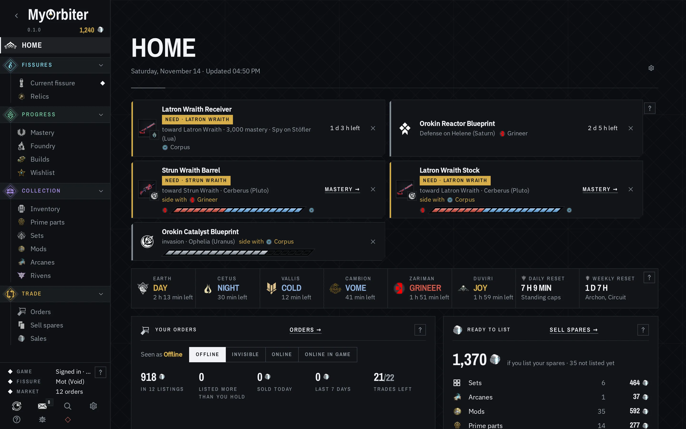
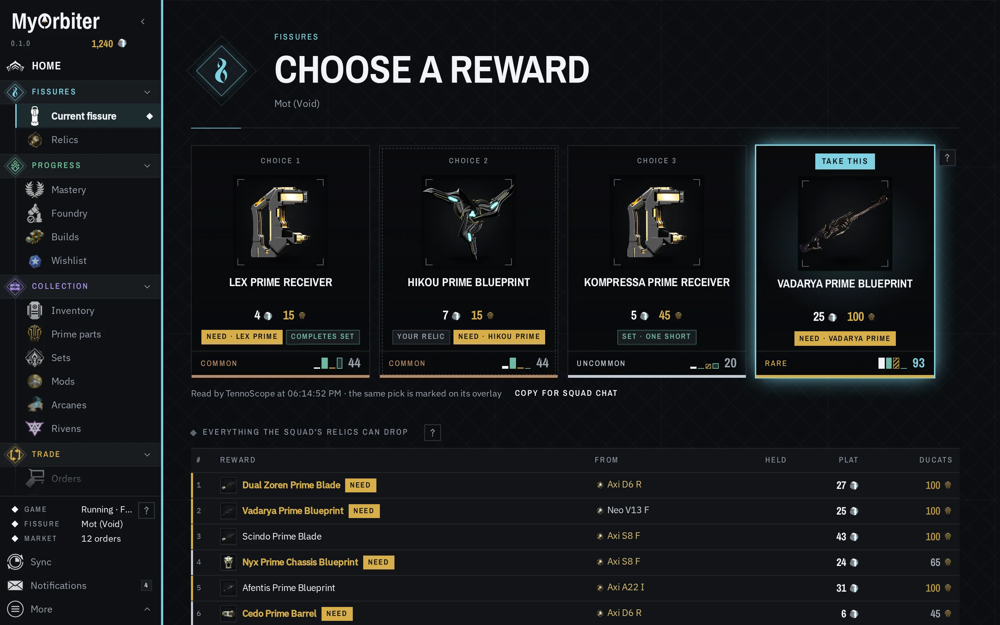
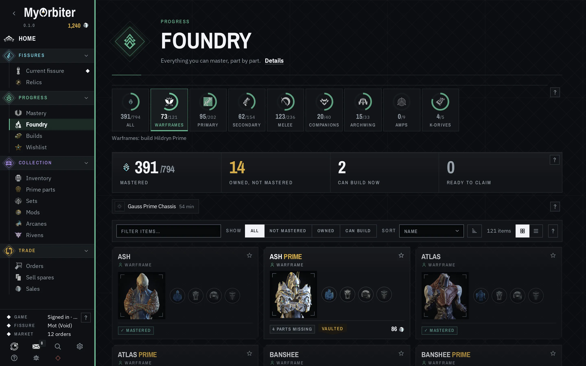
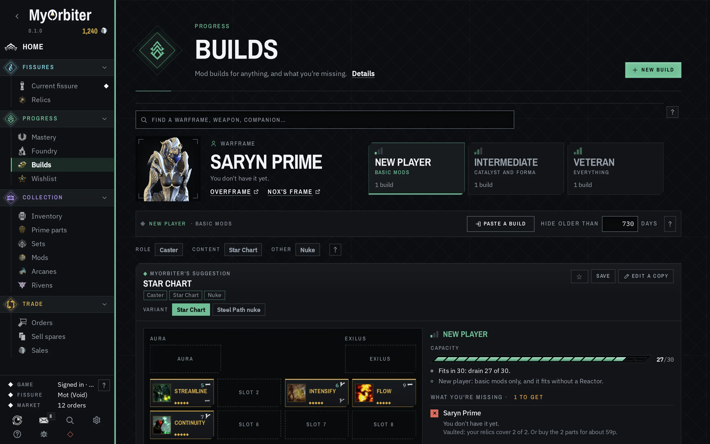
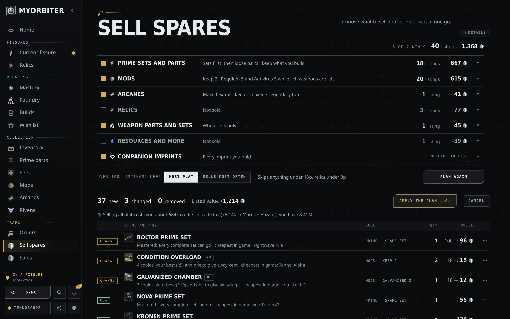
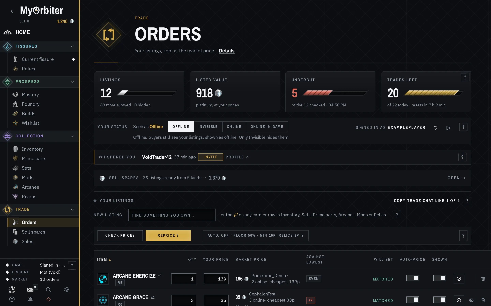

# What MyOrbiter does

Every page, what it shows and what it does. The in-app Guide (the **?** at the bottom of the sidebar, or F1) says the same from inside the app.

A local desktop companion for Warframe that reads what TennoScope (`tennoscope/ORBITER.md`) already stores on your PC and answers the questions TennoScope's collection view doesn't:

- **Home.** Today at a glance (the gear by the date chooses which cards it shows). The world's clocks along the top (day and night on Earth, the Plains, Orb Vallis, the Cambion Drift and the Zariman, and the daily and weekly resets), what needs you first (alerts and invasions with something you haven't mastered, rare alert rewards, listings to fix, Varzia's rotation ending with primes you need), then your market (your warframe.market status with a switch, listed value, what you sold today and this week), what's ready to sell under the rows you turned on in *Sell spares*, the open fissures per era with your best relic for each and what a crack of it is worth (with *fissure alerts* under them: any number of kinds (normal, Steel Path, Void Storm), eras, mission types and planets, and a notification when a matching fissure opens; *Only my alerts* narrows the board to the fissures they match), what's worth doing today (the Duviri Circuit's warframes and Incarnon adapters marked against what you've mastered and own, Teshin's Steel Path offer, the Sortie, the Archon Hunt and its shard, Nightwave challenges by standing), your Foundry (each build with its countdown, and things you have every part for), *Cheap buys* (see below), the easiest mastery to go for next, Baro Ki'Teer's countdown and, while he's here, his stock marked against your collection (mastery you lack, mods new to you), the ducats you hold and what your spare parts would add, and Varzia's rotation with the primes you still need from it.
- **Notifications.** The bell at the bottom of the sidebar: *Recent* lists what MyOrbiter told you, newest first (the number on the bell is how many are new; click one to open the page it's about), and *Choose* has a switch for each kind, grouped (Trading, World, Fissures, Your account), with a pause (for an hour, until tomorrow morning, or until you turn it back on), pop-ups inside MyOrbiter and desktop notifications on or off, *Recent only* to keep a kind out of pop-ups, *Quiet while I'm in a fissure*, and a test; *Recent* keeps the last 100. While you're looking at MyOrbiter a notification pops up in its corner; otherwise it goes to your desktop, where clicking it (Linux and Windows) brings MyOrbiter up on what it's about. The kinds: your listings (repriced, sold, more than you hold, problems), warframe.market messages, a player whispering you in game (read from `EE.log` as the game opens the chat tab), a cheap buy, a riven you're watching for listed at your price, the two rolls of a riven you're cycling; an invasion rewarding a part for something you haven't mastered (with the side to take), an alert rewarding something you haven't mastered or a part toward it, an alert with a rare reward (Orokin Catalyst or Reactor, Forma, Exilus Adapter, Nitain), Baro arriving with things new to you, Varzia's rotation with primes you need, the Duviri Circuit's weekly picks, a Foundry build finishing; a fissure matching one of your fissure alerts, an era opening for your wishlist (rare: every era usually has fissures open), which reward to take; a set you were saving for complete; and TennoScope trouble. *Choose* can also forward the kinds you pick to a Discord webhook (see `docs/privacy.md`). Alerts and invasions worth a look are also listed under *Needs you* on Home. Cheap buys: every 10 minutes MyOrbiter checks the order books for the parts missing from sets one or two parts short and for unranked copies of the arcanes you've started but not finished collecting (about 20 items, most valuable first), and flags any seller in game at 60% of the daily median or less (only for things usually worth 6p or more); warframe.market's live feed of new orders is checked the same way as each one goes up, against up to 300 things you're after. *Copy whisper* on Home copies the same message warframe.market's *Buy* button does, to paste in game chat. Foundry builds, your mastery rank, platinum, credits, Endo and rivens come from MyOrbiter's TennoScope (`tennoscope/ORBITER.md`).
- **Cards.** The collection pages (Foundry, Mastery, Inventory, Arcanes, Mods, Rivens, Relics, Sets, Prime parts and Market) show items as cards with their artwork, part icons and prices; a Cards/Table switch above each of them shows a sortable table instead, remembered per page. A gold notch in a card's corner marks one to look at (point at it for why): spares you can sell, gear you own but haven't mastered, a relic with a part you need, an arcane you've maxed. Clicking a warframe, weapon or companion anywhere opens its details.
- **Hover for details.** Point at anything with a name, anywhere in the app, and a card shows what it is: a relic's rewards with their intact and radiant odds and prices and what one crack is worth; a part's price, ducats, sales per day and the relics that drop it (yours first); a set's parts; a warframe or weapon's key stats, parts and mastery; a mod or arcane's effect at max rank, polarity, copies held and prices. Moving off, scrolling or Esc closes it.
- **Foundry.** Everything you can master, by category (warframes, primary, secondary, melee, companions, archwing, other), each as a card with every part it's built from as a round icon: gold when you have enough, dashed while it's building, dark when you have none, with the count you hold. Filter to what you haven't mastered, what you own, what you can build now or your wishlist (the star on each card); sort by name, closest to done, mastery or set price. *Item details* (a click on a card) shows the artwork, description, its stats (health, shield, armor, energy and polarities for a warframe, with its abilities and passive; damage by type, critical, status, fire rate, magazine and reload for a weapon), what it's built from with the credits and time, where each part drops (the relics you hold first, with how many), how to get it, and its price: the daily median, the cheapest seller in game right now and the best buyer online.
- **Builds.** Mod and arcane builds for any warframe, weapon or companion, in three tiers (*New player*: basic mods; *Intermediate*: a catalyst and Forma; *Veteran*: everything), with MyOrbiter's own suggestion for each, popular builds from Overframe and Nox's Frame, and *Paste a build* or *New* for your own. Each build shows its slots, its capacity against what the item has, and what you're missing for it: mods you don't hold, the item itself, and what buying them costs.
- **Wishlist.** What you've starred in Foundry, Mastery or an item's details, or added by name. For each missing part: the relics you hold that drop it, with the chance of your best copy (lit when a fissure of that era, or an Omnia fissure, is open right now); where to farm a relic for it if you hold none; whether it's vaulted or Varzia has it; and its price. Each item shows the chance your relics finish it if you crack every copy once, and what buying the missing parts costs. *Crack now* collects the relics to run in the fissures open at the moment; Home shows the same in a card.
- **Rivens.** Every unveiled riven you own, read from the game (needs MyOrbiter's TennoScope): its name, rank, cycles, mastery and polarity, the Kuva spent cycling it and what the next cycle costs, each stat as the game shows it, and how good each roll is, graded from S (top of its range) through B (the middle) to F, with an overall grade. After you cycle one, its card shows the roll you had before, graded the same way, and whether the new one is better (or that you kept the old one). While you choose (press Sync at the cycle screen), both rolls show side by side with which to keep (by their stats; what similar rivens are listed for and each roll's Estimate settle a close call), and a notification says the same; TennoScope's overlay shows both rolls graded over the game too, for 25 seconds (Settings, Overlays, Cycling a riven). Set a *riven key* there (a function key, or one with Ctrl, Alt, Shift or Super: Ctrl+Shift+R, F9…; while it's set, the game doesn't get that key) and press it at the cycle screen instead of switching to MyOrbiter: TennoScope reads the inventory and the rolls show a few seconds later. On Linux the key works while the game has focus (the game runs under X11 through Proton). *Price check* finds comparable rivens on warframe.market (same weapon, same main stats) and shows the cheapest and a typical price, the cheapest riven of any kind for the weapon, and *Its stats on the market*: from the weapon's 60 cheapest listings, how many carry each of your stats and what those ask. Then an *Estimate*: what a riven like it is listed for, from MyOrbiter's own price model, with the middle half of such listings as a range and what each stat does to the guess. The model reads all of a riven's stats and how good each roll is, its curse, cycles, mastery and rank, what its weapon's rivens traded for in game last week and what the cheapest listed for it ask now; it was trained on about 80,000 listings for 220 weapons and, on listings from sellers it hadn't learned from, half its guesses were within ×1.6 and 65% within ×2, against ×2.1 and 45% for the similar-listings figure (see `scripts/riven-model/README.md`). The last check is kept between runs, so the prices show at once when you open the page (with when they were checked), and ones over a day old are checked again by themselves, one after another. Each card's *Sell* puts it up as an auction, its buyout starting at the Estimate. *Find a riven* searches warframe.market by weapon, wanted stats and curse, grading each listing from the numbers its seller typed, with each one's Estimate, an *N% under* mark on ones well under it, and a *Best deal* sort; *Alert me* checks every 5 minutes and notifies you when one is listed at or under your price. Every weapon's riven disposition is 1.2 since the 22 October 2026 hotfix, so MyOrbiter uses that.
- **Stats.** Your platinum, credits, Endo, ducats, Aya, Kuva, Void Traces, Vosfor and relics held over time, and your inventory's value, one point each time TennoScope reads your account. Revenue, spending and profit by type (prime parts, sets, arcanes, mods, relics, rivens), and every trade from the game log: sales, purchases and swaps, with who you traded with and the items as icons.
- **Browse market.** Everything warframe.market trades, yours or not: by category, price range and trades a day, with *Sold weekly* (on to start) leaving out prices from a sale or two. Open an item for its 90-day price history, or *Buy order* for the live cheapest seller and best buyer.
- **What's new.** After an update, a short list of what changed since you last opened MyOrbiter, shown once; the Guide keeps the full list and says which build you're running.
- **Sets to sell.** Complete prime sets you hold, with the set price, the price as loose parts, and the ducat value. One set is kept back for anything you have neither built nor mastered; you can turn that off. The *Almost complete* view lists sets that are one or two parts short, what those parts cost, and *Finish & sell*: the set price minus buying the missing parts minus what the parts you have would fetch loose.
- **Prime parts.** Every part you hold, filtered by whether you've mastered the item it builds, with its best use: *Keep* (one full set is kept back for anything you haven't mastered or built, so you can still build it), *Sell as set* (part of a complete set you can sell; its *List* button lists the set), *Sell*, or *Ducats* (better traded to Baro Ki'Teer). You set what a ducat is worth to you (10:1 by default) and the smallest sale worth a trade (5p by default); slow sellers lean to ducats when it's close. The band totals your spares both ways and shows when Baro arrives. The table also shows platinum value, ducats, ducats per platinum and vault state.
- **Mastery, easiest first.** Everything you haven't mastered, with your mastery rank and what the next one takes at the top, ranked by how hard it is to get: five pips from *buy the blueprint in the Market and build it* to *Liches, Sisters and Coda*, with the game's own icon for where it comes from (credits, a syndicate's sigil, the dojo, Baro, relics), the mastery it's worth at max rank, and how to get it in a sentence. Things you own come first (just level them); among equally easy things, the one worth more mastery comes first. Modular gear is listed by the part its mastery goes by (a kitgun's chamber, a zaw's strike, an amp's prism, a MOA's or hound's model, a K-Drive's board), once, with the next step: buy the part, assemble it, gild the build, or level it. How to get each item comes from two places: about 300 items researched one by one on the official wiki (every warframe rated by what players report about farming it, from Steam and forum threads, which its details show as *Players*) (Kuva and Tenet weapons, Baro and Nightwave items, quests, vendors, incubator companions, dojo research), and the game's drop tables for the rest (where each blueprint and part drops, syndicate rank titles, bosses, bounties, rare resources). Open a prime to see the relics that drop each missing part, which ones you own, and which are vaulted, plus what the missing parts cost on warframe.market. What you only have to level says whether it's in your arsenal, built and waiting in the Foundry, or still building (and when it's ready).
- **Arcanes.** Ranks arcanes by price, by slot, and by the collection at Loid whose packs hold them. When your copies make whole maxed arcanes beyond the one you keep (43 copies of a 21-copy arcane make one more), *List* lists them at max rank and says how many to fuse in game first. *Still collecting* (the default) leaves out any you already have maxed or hold enough copies to max; *All* shows everything. Each row shows collection progress, the cheapest way to finish it, and how many spare copies you could sell. *Sell or dissolve* takes every spare copy (maxed copies beyond the one you keep, and loose unranked copies once you have enough to max) and says whether to sell it or dissolve it at Loid for Vosfor, with both amounts side by side. Vosfor is valued through Loid's arcane packs (200 Vosfor for three arcanes from one collection), either by the arcanes in a pack you're still collecting, at what buying those copies would cost (the default), or by all three at market price; the best pack is used. Under your smallest worthwhile sale, untradable, or trading under 5 times a day (unless it would still sell within the week for twice what its Vosfor is worth), it's *Dissolve*; arcanes that trade under 5 a day also count for nothing in a pack valued at market prices. Above the table, each pack shows the arcanes you still need from it and the chance per pack. *Sell spares* leaves arcanes marked *Dissolve* off the market. Yields and pack contents come from the official wiki.
- **Duplicate mods.** Mods you have spare copies of. Two copies are kept: your best one, to use, and one of the lowest rank, to give a new player. Copies fitted in a build are never spare and count toward those two (a fitted copy is the one you use), but one loose copy to give away is always kept. Requiem and Antivirus mods keep five each while lich weapons are left. Shown with ranked copies, listing price, and trades per day, so you know which ones actually sell.
- **Current fissure.** Live while you play. It lists this session's missions with start times, fissure rounds and the relic rewards you got. When a void fissure loads, each relic the squad brought shows up with its refinement, a *Vaulted*/*Farmable*/*Resurgence* tag, its rewards, and the parts you still need. It also shows the most valuable reward on the table. This view reads Warframe's own `EE.log`; the game logs every relic it loads for the squad.
- **Reward pick.** On the fissure reward screen, every card gets a score from 0 to 100: the weighted average of its price (as a share of the best card), whether it's a part for something you haven't mastered or built and don't hold enough of (a part being crafted in your foundry counts as held, and an item being built counts as built), its ducats (out of 100), and whether it completes a set (half if it leaves the set one part short). The default weights follow plat → unmastered → ducats → complete set, each counting double the next (8, 4, 2, 1); change them in Settings → Fissures. Prices are the live ones TennoScope's overlay shows on the cards, so the score and the number on the card agree (the daily median until those arrive). Warframe only logs your own reward, so the four cards come from MyOrbiter's TennoScope, changed to share what it reads off the screen (see `tennoscope/ORBITER.md`); the same change shows the score and **Pick** on TennoScope's overlay over the game. Without it, *Current fissure* ranks everything the squad's relics can drop, so you take whichever of your cards is highest. MyOrbiter switches to *Current fissure* when the reward screen opens (turn that off in Settings).
- **Inventory.** Everything TennoScope last read from your account, like its collection screen: gear (with mastery), prime parts, relics, mods and arcanes by rank, resources and blueprints, each with its market value, ducats and trades per day. Filter by kind, by name, by trades a day and by price each (both minimums), to what warframe.market trades (*On warframe.market*), or to what you can spare, and list anything you can spare. *Not needed* lists gear you can't trade and no longer need, to sell for credits in game: a weapon, frame or companion once you own and have mastered a version that does everything it does (the Dual Decurion once you have Prisma Dual Decurions; MK1 below the plain one, every other version above it, and a Prime and a Vandal aren't upgrades of each other), and extra copies of something mastered. Kept back, with why: one you haven't mastered, what a recipe you haven't mastered takes (two Broncos for an Akbronco), one whose Incarnon Genesis is installed when the better one has none (MyOrbiter's TennoScope passes each copy's Incarnon, catalyst and Forma), and anything you chose to keep.
- **TennoScope, built in.** MyOrbiter needs TennoScope running (it reads TennoScope's data, and TennoScope reads the reward cards and syncs your inventory), so it starts it in the background when MyOrbiter opens and closes it when MyOrbiter closes; you only open MyOrbiter. The **TennoScope** button at the bottom of the sidebar opens a panel with what TennoScope reports about itself (game, log, reward-screen reading, prices, warframe.market account), a button for the screen-capture permission the reward overlay needs, and *Sync inventory now*. *Open its window* is there for anything else, like choosing its access level. If TennoScope stops, MyOrbiter notices within 15 seconds and starts it again (one that keeps stopping is given longer each time, up to 10 minutes); a TennoScope you started yourself is left running. This needs MyOrbiter's TennoScope (`tennoscope/ORBITER.md`).
- **Orders.** Your warframe.market sell listings: create, edit, hide and remove them; set your warframe.market status (*Invisible*, *Online* or *Online in game*: buyers only see your listings while you're online), which MyOrbiter holds on its own connection while it's open, restores when it starts, and drops when you quit (so you show as offline; *Online in game* shows as that only while TennoScope sees Warframe running, *Online* otherwise); get a warning when a listing is for more than you hold, with *Sold N* to mark it sold on warframe.market and log the sale in one click (or *Didn't sell* to just fix the quantity); *Sold* on any listing does the same; your listings are re-read from warframe.market every 30 seconds (every 2 minutes while MyOrbiter's window is hidden), so changes made on the website show up on their own; and keep each one near the market (*Check prices* and *Reprice*, or on a timer with *Apply automatically*, which is off unless you turn it on). The price followed is the second-cheapest seller who is *online or in game* right now, one listing per seller (same rank and variant, a platform you can trade with, never your own listing), so a single bait listing is never followed. Example: with offline 15p, online 17p, in game 20p and in game 23p, a listing at 25p goes to 20p; one at 12p goes up only to 17p, the cheapest seller. It raises as well as lowers, but never above the cheapest seller, and not at all while one sits under it. A price changes only when it has drifted: by more than 2p or 5% of its price, whichever is more (a listing under one of its floors is raised to it whatever the gap). Unattended, a listing changes at most once an hour and 6 times a day; the times are kept in the settings, so a restart doesn't reset them. The numbers live in `src/lib/core/drift.ts`. warframe.market calls automation like this a grey area and may limit apps that do it. When every seller online or in game asks more than twice what it sold for lately, it's priced at what it sells for. Relics have their own minimum (3p by default). It never drops under a floor: your own per-listing minimum, or a share of the item's daily market price (50% by default). Typing a new quantity or price holds the change (shown in gold) until you press Enter or *Save*; Esc or *Undo* puts it back, and the repricer leaves that listing alone meanwhile. *Remove* asks once more before it takes a listing down. Under your listings: your buy orders (posted from Wishlist, Mastery, Prime parts or Market) with *Remove*, and your riven auctions with their Estimate, a new buyout and *Take down*. *Copy trade-chat line* puts your shown listings on the clipboard for trade chat. After a trade in game, MyOrbiter gives the other player +rep on warframe.market with your message, once per player (Settings → Trades; off, a +rep button shows instead). Optionally (Settings → Trades), a whisper hides every listing you have one copy of for 10 minutes, so a second buyer doesn't come for one already promised.
  Orders shows how many more you can list. *Remove all my listings* takes everything off warframe.market after a second click. *Check prices* shows, per listing, what it would change to (old → new) and *Reprice* sends it. The chart icon beside a listing opens what it sold for over the last 90 days, with your price and the market price drawn across it. *Check automatically* reads the order books on a timer (every 1 to 60 minutes, 5 by default) and shows what each listing would change to; *Apply automatically* also sends the new prices, but unattended it never takes a listing under 70% of the price you last set or approved for it (listing it, typing a price on Orders, pressing *Reprice* or applying a Sell spares plan; a listing MyOrbiter hasn't seen you price starts from its current price): it stops there and a notice says so, for you to decide. Nor does it ever more than halve one in a pass, or go under your minimum. *Reprice* pressed by hand can go lower, and its price becomes the one you approved. Every row of something you can sell (sets, prime parts, plat or ducats, arcanes, mods, relics) ends in a *List* button. It opens a small form over the page you're on, with the quantity set to what you can spare and the price matched to the cheapest seller in game. If you already list the same thing, it offers to add to that listing instead of making a second one.
- **Sell spares** (in Trade, after Orders) brings your listings in line with what you can spare, one row per kind, each with its own choices and a summary of them: *Prime sets and parts* (whole sets first, then loose parts, or either alone, and optionally only sets whose every part drops from a relic you hold; what you still have to build or master is kept, plus as many more of each part as you set, and parts going out in a set or worth more as ducats never go), *Mods* (two of each kept, your best copy and one to give away; Requiem and Antivirus mods five each while lich weapons are left; Primed, Galvanized, augments and stances each on or off with their own number; only mods that sell daily, unless you say otherwise), *Arcanes* (maxed copies beyond the ones you keep, or every spare copy; Legendary ones too, or not), *Relics* (the ones worth more sold than cracked, keeping as many of each as you set), *Weapon parts and sets* (whole sets only, sets then loose parts, or loose parts alone), *Resources and more* (by kind: refined gems, fish, Ayatan sculptures, empty or filled with your spare stars, Ayatan stars, Captura scenes, focus lenses, and keys and the rest, with veiled rivens when Settings → Selling allows them; what gear you haven't built still takes is kept, plus a margin you set) and *Companion imprints* (by breed, keeping as many as you set). Each row shows how many listings it would make and what they're worth. Prime sets and parts, mods, arcanes, weapon parts and sets, and imprints are on to start. *Plan the changes* fetches the order books and shows every line it would list, resize, reprice or take down, with its rule and why, priced at the cheapest seller in game; *Apply the plan* sends it. The ⋯ on a line leaves it out of this plan only, or for good (*Never sell*: no path lists it, the listing form included, until *Sell again*). Anything under your minimum price (10p by default, 3p for relics; the repricer never goes below it either) is left out, or taken down if it's listed. Before anything is sent, the plan is worked out again from your current inventory and listings (if anything changed it shows the new plan instead), it isn't sent at all if your listings can't be read first, and every listing passes a last check: never more copies than the keep rules prove spare, never a prime part or set under its ducats, never from an inventory read more than 3 hours old. Only the rows you turned on are touched: listings you set to be left alone, hidden ones and anything else on your profile stay as they are, and a listing you made yourself is only lowered or removed once you hold fewer than it offers. warframe.market allows 100 orders per account (buy orders count too): when the plan would go over, *Over 100 listings? Keep* chooses which win, *Most plat* (quantity × price) or *Sells most often*; the cheapest new ones are left out, and your cheapest existing listings in the rows you turned on come down to make room; the plan says so before you apply it.
- **Planner.** *Complete sets*: the relics you own ranked by how likely one crack is to drop a part missing from a nearly complete prime set (one or two parts away by default), using the odds of your best copy of each relic. It lists the sets one part from done, and the ones none of your relics can finish. *Make radiant*: which relics gain the most from 100 Void Traces, solo or in a 4-person radshare (best of four rewards), measured in platinum, ducats, or the chance of a part you still need.
- **Sales.** What you've sold: platinum today, over 7 and 30 days and everything logged, a bar per day, your best sellers (tagged *sells often* when they sold three or more times in 30 days: keep them listed, and list more), and each sale next to the item's daily median (*under* when it went for less than 80% of it), with the 30-day average in the band. Sales log themselves from the game: when you accept a trade, Warframe writes the trade dialog to `EE.log` (what you offered, the buyer, `Platinum x 17`), then "The trade was successful!". When you gave items and got only platinum (in the last half hour), MyOrbiter matches each item to your listing (only a sure match: the same rank and variant, and paid near its price), marks it sold on warframe.market (its own close-order call, the same as the website's *Sold*, so the sale is recorded on your profile and the listing lowered or closed), logs the sale at the platinum you actually received, notifies you and asks TennoScope to read your inventory again. The game writes its log in bursts, so this usually lands within half a minute. Each trade is handled once, and a sale you logged by hand within ten minutes isn't logged twice. Turn it off in Settings → Trades. *Sold* on any listing in Orders does the same by hand in one click (*more…* for several), and trades made outside the game can be added by hand. Kept in MyOrbiter's settings file, the last 2,000.
- **Relics and fissures.** Your relics by refinement, tagged *Vaulted*, *Farmable* or *Resurgence* (in Varzia's stock right now), with the parts you still need from each. Sort by average platinum per crack, intact or radiant, or by how much refining to radiant adds; switch between solo (the default) and a radshare of four (best of four rewards); the choice is shared with the Planner and Home. Opening a relic shows each reward's intact and radiant odds. Rewards with no market price (Forma, Kuva, Riven Slivers) count as 0p; each reward counts at its price or its ducats at your rate, whichever is more, and a relic with an unpriced Prime part shows no average. The fissure strip shows the active fissures for each era. Click an era to see the relics you can crack there. What each relic holds and whether it's vaulted come from the official drop tables, which MyOrbiter reads itself (through drops.warframestat.us, checked twice a day and kept for offline use) and lays over TennoScope's relic list: a new Prime Access's relics show up within a day or two, and relics that leave the drop tables turn vaulted. A relic neither knows is listed under the table instead of disappearing.

## Getting around

MyOrbiter opens on the page you left it on, or the one you choose in Settings → *Pages*, where you can also take pages you don't use out of the sidebar. The sidebar groups the rest by what you're doing, each page with the game's own icon where there is one:

- **Fissures**: *Current fissure*, *Relics*, *Planner*: before and during fissure runs.
- **Progress**: *Mastery*, *Foundry*, *Builds*, *Wishlist*: what's left to get, build and mod.
- **Collection**: *Inventory*, *Prime parts*, *Sets*, *Mods*, *Arcanes*, *Rivens*: what you hold.
- **Trade**: *Orders*, *Sell spares*, *Browse market*, *Sales*, *Stats*.

*Planner*, *Browse market* and *Stats* start out of the sidebar; Settings → *Pages* puts them back and moves pages and sections.

Under 1180 px wide the sidebar folds to icons; the arrow by the name folds or unfolds it by hand, and that choice is kept. *Orders* carries a count of listings for more than you hold. The **?** at the bottom opens the guide.

*List* at the end of a row lists it on warframe.market without leaving the page. Rows marked › open with a click (or Enter) for details, relic odds and warframe.market links. Column headers sort. Each page keeps its filters and scroll position while MyOrbiter is open. On narrow windows the less important columns are hidden.

On the desktop:

- **Notifications** through your desktop's own notification service (Plasma, GNOME Shell, or mako, dunst or swaync on Hyprland) while MyOrbiter isn't the window you're looking at, tagged with its launcher entry so they carry its name and icon; clicking one brings MyOrbiter up on what it's about. What they're about, and the switches: the bell in the sidebar (see *Notifications* above).
- **Keyboard:** Ctrl+1…9 opens the pages in sidebar order, Ctrl+K finds anything by name, Ctrl+PgUp/PgDn (or Ctrl+Tab) the previous or next one, Ctrl+F or / jumps to the page's filter, Ctrl+R or F5 syncs, Ctrl+, opens Settings, F1 the guide, Shift+F1 Report a bug, Esc closes a panel or form, Ctrl+Q quits.
- **A dark window:** GNOME draws the title bar dark to match; KDE and Hyprland use your own window theme. Right-click only offers a menu where it's useful (text fields and selected text), not a web page's Back and Reload.

## Known limits

- Your listings are only visible to other players while your warframe.market status is online or in game, and warframe.market only keeps a status while a connection holds it: when MyOrbiter closes, you show as offline. While MyOrbiter holds your status, MyOrbiter's TennoScope closes its own status connection and refuses status changes from its window, so the two never undo each other.
- The in-game relic picker (before a mission starts) isn't in the log, so the squad's relics appear once the mission loads. To pick a relic beforehand, use *Relics*.
- Vault state comes from the official drop tables (through drops.warframestat.us), which lag a game update by a day or two. Varzia's items are matched by item, because her special resurgence relics aren't in that data.
- How hard something is to get is a judgement on a 1–5 scale. For the ~300 hand-researched items it follows the wiki as of October 2026; for the rest it's worked out from drop data, so an item whose source changed since TennoScope's catalog was built can be off. Dojo items assume your clan has the research.
- Finish odds count only your own relics, each cracked once at the refinement you hold. Squadmates' relics in a radshare aren't counted.
- A riven's roll before a cycle is known only if MyOrbiter saw it: the first read after you start using MyOrbiter is the starting point.
- Mod and arcane values are warframe.market median prices. Check *Trades/day* before counting on selling 200 copies of Thumper.

## Look

The interface follows TennoScope's lead, a Warframe-style ledger: a dark slab with faint engraved rings, square corners, condensed capitals for names and titles, small tracked monospace labels, and two metals for values, platinum and gold. Pages, currencies, relic eras, syndicates and traders use Warframe's own icons (platinum, ducats, credits, endo, vosfor, relics by era, syndicate sigils, Baro, Varzia), bundled in `public/game` and taken from the official wiki and WFCD; `public/game/SOURCES.json` records where each came from. Everything else is MyOrbiter's own CSS and line icons; the fonts are Archivo Narrow, IBM Plex Sans and IBM Plex Mono (all OFL), bundled with the app.

## Screenshots

All of the invented account in `demo/` (`npm run dev:demo`).

| | |
| --- | --- |
|  |  |
| **Home** | **Current fissure**: the reward screen, scored |
|  |  |
| **Foundry** | **Builds** |
|  |  |
| **Sell spares** | **Orders** |
